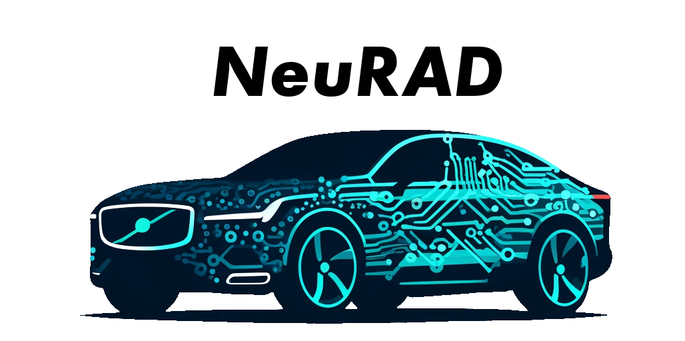
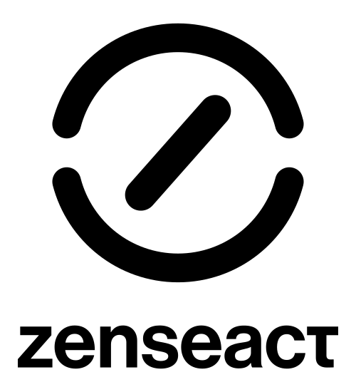
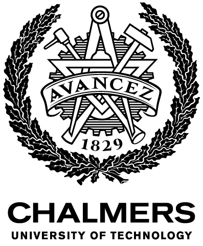
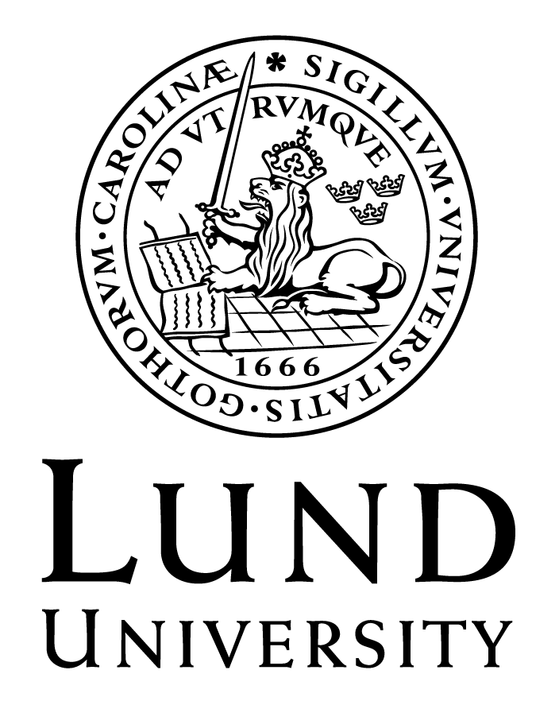
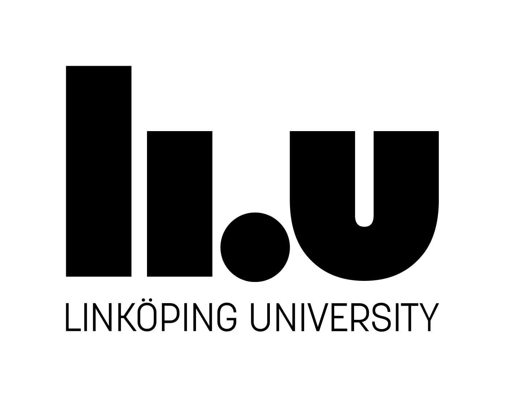
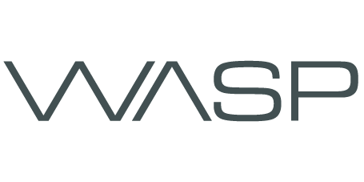

<p align="center">
    <!-- project badges -->
    <a href="https://research.zenseact.com/publications/neurad/"></a>
    <a href="https://research.zenseact.com/publications/splatad/"></a>
    <!-- paper badges -->
    <a href="https://arxiv.org/abs/2311.15260">
        
    </a>
    <a href="https://arxiv.org/abs/2411.16816">
        
    </a>
</p>


<div align="center">
<picture>
    <source media="(prefers-color-scheme: dark)" srcset="docs/_static/imgs/neurad_logo_with_text_dark.png" />
    
</picture>
</div>

<div align="center">
<h3 style="font-size:2.0em;">Neural Rendering for Autonomous Driving</h3>
<h4>CVPR 2024 highlight + CVPR 2025</h4>
</div>
<div align="center">

[Quickstart](#quickstart) ·
[Learn more](#learn-more) ·
[Datasets](#adding-datasets) ·
[Project page](https://research.zenseact.com/publications/neurad/)

</div>

# About

This is the official code release of the following papers:
- CVPR 2024 [paper](https://arxiv.org/abs/2311.15260) _NeuRAD: Neural Rendering for Autonomous Driving_
- CVPR 2025 [paper](https://arxiv.org/abs/2411.16816) _SplatAD: Real-Time Lidar and Camera Rendering with 3D Gaussian Splatting for Autonomous Driving_

NeuRAD and SplatAD reconstruct dynamic driving scenes from camera and LiDAR data.
Contributions of new models, datasets, and fixes are welcome.

<div align="center">
<a href="https://zenseact.com/">
<picture style="padding-left: 10px; padding-right: 10px;">
    <source media="(prefers-color-scheme: dark)" srcset="docs/_static/imgs/ZEN_Vertical_logo_white.svg" />
    
</picture>
</a>
<a href="https://www.chalmers.se/en/">
<picture style="padding-left: 10px; padding-right: 10px; padding-bottom: 10px;">
    <source media="(prefers-color-scheme: dark)" srcset="docs/_static/imgs/EN_Avancez_CH_white.png" />
    
</picture>
</a>
<a href="https://www.lunduniversity.lu.se/">
<picture style="padding-left: 10px; padding-right: 10px;">
    <source media="(prefers-color-scheme: dark)" srcset="docs/_static/imgs/LundUniversity_C2line_NEG.png" />
    
</picture>
</a>
<a href="https://liu.se/en">
<picture style="padding-left: 10px; padding-right: 10px;">
    <source media="(prefers-color-scheme: dark)" srcset="docs/_static/imgs/LiU_secondary_1_white-PNG.png" />
    
</picture>
</a>
<a href="https://wasp-sweden.org/">
<picture>
    <source media="(prefers-color-scheme: dark)" srcset="docs/_static/imgs/WASP-logotype-white.png" />
    
</picture>
</a>
</div>

# News
[June 2025] Code for [SplatAD](https://research.zenseact.com/publications/splatad/) is now released in neurad-studio. The code uses our custom fork of gsplat, found [here](https://github.com/carlinds/splatad), for handling rolling shutter and lidar rendering. For Apptainer users we provide [a recipe](apptainer_recipe) that lets you build an image with all the needed dependencies.


# Quickstart

Train **SplatAD** or **NeuRAD** on a PandaSet sequence. The supported setup uses
Linux, an NVIDIA GPU, Python 3.12, and CUDA 12.8. Docker is the simplest starting
point; it includes Python and the CUDA compiler.

| Setup | Prerequisites | Instructions |
| --- | --- | --- |
| Docker | NVIDIA driver supporting CUDA 12.8 and GPU-enabled Docker | Follow the steps below |
| Local development | uv, Git, GCC/G++, CUDA 12.8 toolkit and NVIDIA driver | [Local setup](docs/setup.md#install) |
| Apptainer / HPC | Apptainer and NVIDIA driver | [Build and run a SIF](docs/setup.md#apptainer) |

## 1. Build the environment

```bash
git clone https://github.com/georghess/neurad-studio.git
cd neurad-studio
docker build -t neurad-studio .
```

For a faster first build, target your GPU with
`--build-arg TCNN_CUDA_ARCHITECTURES=120` for an RTX 5090, for example. See the
[GPU architecture options](docs/setup.md#docker) for other GPUs. Subsequent source
edits reuse the dependency build. The custom gsplat fork is installed automatically.

## 2. Download data

Download [PandaSet](https://huggingface.co/datasets/georghess/pandaset) and extract
it under `data/pandaset`. For the example below, sequence `001` should be at
`data/pandaset/001`. Dataset-specific instructions are linked in the
[dataset table](#adding-datasets).

## 3. Train

```bash
mkdir -p outputs
docker run --rm -it --gpus all --shm-size=8g --ulimit nofile=65536:65536 \
    -p 127.0.0.1:7007:7007 \
    --mount type=bind,src="$PWD/data/pandaset",dst=/data/pandaset,readonly \
    --mount type=bind,src="$PWD/outputs",dst=/outputs \
    neurad-studio ns-train splatad --output-dir /outputs \
    pandaset-data --data /data/pandaset --sequence 001
```

Replace `splatad` with `neurad` to train NeuRAD. In an activated local environment,
the equivalent command is:

```bash
ns-train splatad pandaset-data --data data/pandaset --sequence 001
```

First-run CUDA compilation can take a few minutes. Open the
viewer URL printed in the terminal; for a remote host, forward port 7007, for
example with `ssh -L 7007:localhost:7007 user@host`.

If loading fails or the process is killed, check the
[lower-memory settings](docs/setup.md#neurad-loading-memory). For installation
errors, see [dependency troubleshooting](docs/setup.md#missing-gsplat-lidar-functions-or-mismatched-cuda-versions).

## Resume, view, and render

Run these commands inside the container or an activated local environment.
Keep the same data and output mounts when reopening a container.

```bash
# Resume training; use the same model and dataset options as the original run.
ns-train splatad --load-dir /outputs/path/to/nerfstudio_models \
    --output-dir /outputs pandaset-data --data /data/pandaset --sequence 001

# Open a saved run in the viewer.
ns-viewer --load-config /outputs/path/to/config.yml

# List rendering and export commands.
ns-render --help
ns-export --help
```

## Models and configuration

| Model | Description |
| --- | --- |
| `splatad` | [SplatAD](https://research.zenseact.com/publications/splatad/): Gaussian splatting for camera and LiDAR rendering |
| `neurad` | [NeuRAD](https://research.zenseact.com/publications/neurad/): NeRF-based camera and LiDAR rendering |
| `unisim` | [Unofficial UniSim implementation](https://github.com/carlinds/unisim), installed as a plugin |

Use `ns-train --help` to list models, `ns-train splatad --help` for model options,
and `ns-train splatad pandaset-data --help` for dataset options. Nerfstudio's
static-scene methods, such as `nerfacto` and `splatfacto`, are also available.

To log training metrics, set `--vis tensorboard`, `--vis wandb`, or `--vis comet`
before `pandaset-data`. Use `viewer+tensorboard`, `viewer+wandb`, or `viewer+comet`
to keep the viewer enabled alongside logging.

# Learn More

Extend the supported [datasets](#adding-datasets) or add a [method](#adding-methods).
Bug reports and pull requests are welcome.

## Adding Datasets

The following datasets have dataparsers. To add one, create a module in
`nerfstudio/data/dataparsers/` with subclasses of `ADDataParserConfig` and
`ADDataParser`. Implement `_get_cameras`, `_get_lidars`, `_read_lidars`,
`_get_actor_trajectories`, and `_generate_dataparser_outputs` as needed.

| Data                                                                                          | Cameras | Lidars                                                      |
| --------------------------------------------------------------------------------------------- | -------------- | ----------------------------------------------------------------- |
| 🚗 [nuScenes](https://www.nuscenes.org/)          | 6 cameras            |  32-beam lidar                   |
| 🚗 [ZOD](https://zod.zenseact.com/) ([Annotations](https://github.com/user-attachments/files/15773566/auto_annotations.zip))          | 1 camera            | 128-beam + 2 x 16-beam lidars                   |
| 🚗 [Argoverse 2](https://www.argoverse.org/av2.html)   | 7 ring cameras + 2 stereo cameras            | 2 x 32-beam lidars                   |
| 🚗 [PandaSet](https://pandaset.org/) ([huggingface download](https://huggingface.co/datasets/georghess/pandaset))         | 6 cameras | 64-beam lidar                                  |
| 🚗 [KITTIMOT](https://www.cvlibs.net/datasets/kitti/eval_tracking.php) ([Timestamps](https://www.cvlibs.net/datasets/kitti/raw_data.php)) | 2 stereo cameras | 64-beam lidar
| 🚗 [Waymo v2](https://waymo.com/open/)         | 5 cameras | 64-beam lidar
| 🚗 [py123d](https://github.com/kesai-labs/py123d) | user-specified (pinhole) | user-specified |

A brief introduction about Waymo dataparser for NeuRAD can be found in [waymo_dataparser.md](./nerfstudio/data/dataparsers/waymo_dataparser.md).
For training on [py123d](https://github.com/kesai-labs/py123d) Arrow logs, see [docs/py123d-data.md](./docs/py123d-data.md) and the example config [docs/examples/py123d_example.yaml](./docs/examples/py123d_example.yaml).

## Adding Methods

Nerfstudio has made it easy to add new methods, see [here](https://docs.nerf.studio/developer_guides/new_methods.html) for details. We have added [our UniSim reimplementation](https://github.com/carlinds/unisim) as a plugin, which can be run as any other method using the `ns-train` command:
```bash
ns-train unisim pandaset-data --data data/pandaset
```
and follow the instructions in the terminal.

See [our UniSim repo](https://github.com/carlinds/unisim) for reference on how to add a new method as a plugin.

# Key features
- Dataparser for multiple autonomous driving datasets including
    - Dataparsing of lidar data (3D+intensity+time)
    - Dataparsing of annotations
- Datamanager for lidar+image data
- Rolling shutter handling for ray generation
- Viewer improvements
    - Lidar rendering
    - Dynamic actor modifications
- NeuRAD - SOTA NeRF-based rendering method for dynamic AD scenes
- SplatAD - SOTA splatting-based rendering method for dynamic AD scenes


# Built On

<a href="https://github.com/nerfstudio-project/nerfstudio">
<picture>
    <source media="(prefers-color-scheme: dark)" srcset="https://raw.githubusercontent.com/nerfstudio-project/nerfstudio/main/docs/_static/imgs/logo-dark.png" />
    
</picture>
</a>

- Collaboration friendly studio for NeRFs

# Citation

You can find our papers for [NeuRAD](https://arxiv.org/abs/2311.15260) and [SplatAD](https://arxiv.org/abs/2411.16816) on arXiv. You can also head over to [our research blog](https://research.zenseact.com/publications) for project pages and more papers on AD.

If you use this code or find our paper useful, please consider citing:

```bibtex
@inproceedings{tonderski2024neurad,
  title={{NeuRAD}: Neural rendering for autonomous driving},
  author={Tonderski, Adam and Lindstr{\"o}m, Carl and Hess, Georg and Ljungbergh, William and Svensson, Lennart and Petersson, Christoffer},
  booktitle={Proceedings of the IEEE/CVF Conference on Computer Vision and Pattern Recognition},
  pages={14895--14904},
  year={2024}
}

@inproceedings{hess2024splatad,
  title={{SplatAD}: Real-Time Lidar and Camera Rendering with 3D Gaussian Splatting for Autonomous Driving},
  author={Hess, Georg and Lindstr{\"o}m, Carl and Fatemi, Maryam and Petersson, Christoffer and Svensson, Lennart},
  booktitle={Proceedings of the IEEE/CVF Conference on Computer Vision and Pattern Recognition},
  year={2025}
}
```

# Contributors

<a href="https://github.com/georghess">
    
</a>
<a href="https://github.com/carlinds">
    
</a>
<a href="https://github.com/atonderski">
    
</a>
<a href="https://github.com/wljungbergh">
    
</a>
<a href="https://github.com/MartinEthier">
    
</a>
<a href="https://github.com/JulienStanguennec-Leddartech">
    
</a>

\+ [nerfstudio contributors](https://github.com/nerfstudio-project/nerfstudio/graphs/contributors)
